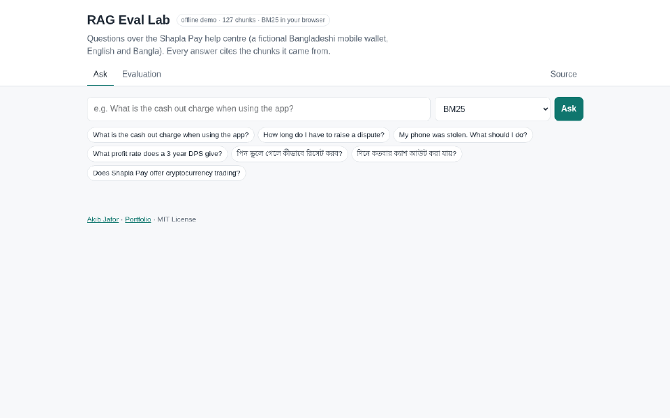
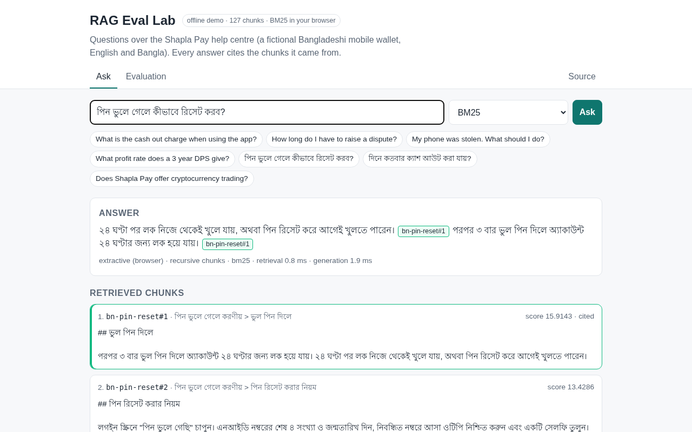
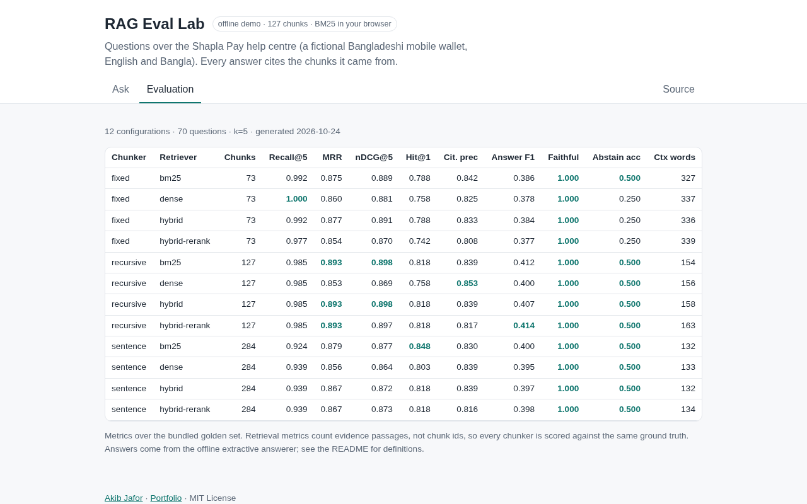
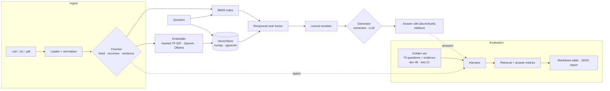

<!-- topics: rag, retrieval-augmented-generation, information-retrieval, evaluation, bm25, hybrid-search, pgvector, fastapi, python, bangla, llm -->
# RAG Eval Lab

Retrieval-augmented Q&A over a bilingual (English + Bangla) help centre, built around an evaluation harness that measures every chunker and retriever combination against a golden set before anything ships.

[](https://github.com/AkibUllah/rag-eval-lab/actions/workflows/ci.yml)
[](https://github.com/AkibUllah/rag-eval-lab/actions/workflows/codeql.yml)
[](https://github.com/AkibUllah/rag-eval-lab/releases)


## Try it live

| | |
|---|---|
| Live demo | https://akibullah.github.io/rag-eval-lab/ — the real web UI in offline mode: a pre-tokenised chunk index and BM25 + the extractive answerer running in your browser (verified to return the same chunks and answers as the Python pipeline for all 70 golden questions). The Evaluation tab shows the test-split comparison grid generated on the last push. |
| Run in your browser | [](https://codespaces.new/AkibUllah/rag-eval-lab?quickstart=1) — installs the package, runs `rag-eval compare --split test` once and starts the API on forwarded port 8000: `/` is the UI with all four retrievers, `/docs` is Swagger. |
| One-click deploy | [](https://render.com/deploy?repo=https://github.com/AkibUllah/rag-eval-lab) — `render.yaml` deploys the Docker image in offline mode (no database, no keys). |
| Local | `docker compose up` (see Quick Start) |

## Screenshots



*Live demo: English and Bangla questions answered with citations, then the evaluation grid.*



*Ask tab: a Bangla PIN-reset question answered extractively, every sentence citing the chunk it came from, with retrieval and generation timings.*



*Evaluation tab: 3 chunkers × 4 retrievers scored on the golden set (Recall@5, MRR, nDCG@5, citation precision, faithfulness, abstention).*

## Why this exists

Most RAG demos I review are tuned by eyeballing three questions. In fintech support that is not good enough: a wrong cash-out fee or a made-up dispute deadline is a compliance problem, not a UX glitch. This repo treats retrieval as something you measure first and tune second. It ships a small but realistic knowledge base for a fictional Bangladeshi mobile wallet (Shapla Pay), a 70-question golden set with verbatim evidence split into dev and test, and a harness that scores chunking, retrieval and answer quality in one command. Everything runs offline with no API keys; real LLM and embedding providers plug in behind small protocols when you want them.

## Features

- **Ingestion**: Markdown, plain text and PDF (text layer via optional `pypdf`) with front matter; NFC normalisation, zero-width cleanup and Bangla digit folding (`৩০,০০০` and `30,000` produce the same term)
- **Bangla-aware tokenizer**: keeps vowel signs inside words (plain `\w` splits `টাকা`), English and Bangla stopwords, light suffix stripping (`-এর`, `-কে`, `-টি`, `-গুলো`)
- **Three chunkers**: fixed-size word windows with overlap, recursive (heading → paragraph → sentence, never crossing a section) and sentence-window (index one sentence, return it with neighbours); all emit character spans into the source
- **Four retrievers**: BM25 (own implementation), dense over hashed n-gram TF-IDF vectors (numpy only), hybrid with reciprocal rank fusion, and hybrid + a lexical reranker
- **Pluggable backends**: `VectorStore` protocol with in-memory numpy and pgvector adapters; `Embedder` protocol with OpenAI-compatible `/embeddings` and Ollama adapters
- **Cited answers**: every claim carries `[doc#chunk]`; the offline extractive answerer quotes the best-supported sentences and abstains below a coverage threshold; optional OpenAI-compatible, Anthropic Messages and Ollama generators over plain httpx
- **Evaluation harness**: recall@k, MRR, nDCG@k, hit rate, citation precision, exact match, token F1, overlap-based faithfulness (optional LLM judge) and abstention accuracy, sliced by tag (Bangla, paraphrase, numeric...), with seeded bootstrap 95% confidence intervals for the headline metrics
- **Dev/test split**: the golden set carries a deterministic, stratified `split` (49 dev / 21 test, seeded hash of the question id, existing questions never move); `--split dev|test|all` on `run` and `compare`, and threshold tuning that refuses the test split
- **CLI**: `rag-eval run`, `rag-eval compare` (markdown table + JSON report), `rag-eval tune` (dev-only threshold sweep), `rag-eval ask`, `rag-eval export-index`
- **API + UI**: `POST /ingest`, `POST /ingest/files`, `POST /ask`, `GET /eval/latest`; a vanilla JS UI that shows the answer, cited chunks and scores, and the latest evaluation grid

## Architecture



Key decisions:

- **Evidence spans, not chunk ids.** The golden set stores the verbatim evidence passage for each question. A chunk is relevant when it covers at least 50% of that passage's character span, so one golden set scores every chunker fairly.
- **Metrics count passages once.** Two overlapping fixed-size chunks containing the same evidence do not double recall or nDCG; a chunk only gains if it covers a passage not seen at a higher rank.
- **Rank fusion, not score mixing.** RRF combines BM25 (unbounded scores) and cosine similarity (-1..1) by rank alone, so there is no weight to tune per corpus.
- **One tokenizer, two runtimes.** The browser demo is a port of the Python tokenizer, BM25 and answerer; stopwords and suffixes are exported with the index, and parity tests check the JS tokenizer over the whole corpus and the full browser pipeline against Python.
- **Offline is the default, not a mock.** The extractive answerer is a real baseline (it never invents text), and the same harness evaluates an LLM generator by switching one env var.

## Evaluation results

The golden set (70 questions: 55 English and 11 Bangla answerable, plus 4 deliberately unanswerable, one of them in Bangla) is split once into **dev (49 questions)** and **test (21 questions)**. Settings are chosen on dev; the numbers below are on test, which nothing was tuned on. The split is stratified (Bangla, unanswerable, and English by multi-document / multi-evidence / paraphrase / lexical wording, about 30% of each in test) and stored in `data/golden.jsonl`, so it never changes between runs.

`rag-eval compare --split test` over the bundled corpus (29 documents, 5 in Bangla), `k=5`, offline generator. Genuine output from this repo; latency is retrieval only, single process on a laptop CPU.

```
$ rag-eval compare --split test
29 documents, 21 questions (split: test), k=5
```

| Chunker | Retriever | Chunks | Recall@5 | MRR | nDCG@5 | Hit@1 | Hit@5 | Cit. prec | Answer F1 | Faithful | Abstain acc | Ctx words | p50 ms |
|---|---|---|---:|---:|---:|---:|---:|---:|---:|---:|---:|---:|---:|
| fixed | bm25 | 73 | **1.000** | 0.917 | 0.920 | 0.850 | **1.000** | 0.900 | 0.457 | **1.000** | **1.000** | 329 | 0.08 |
| fixed | dense | 73 | **1.000** | 0.887 | 0.898 | 0.800 | **1.000** | 0.900 | 0.457 | **1.000** | 0.000 | 336 | 0.58 |
| fixed | hybrid | 73 | **1.000** | 0.925 | 0.926 | 0.850 | **1.000** | 0.900 | 0.457 | **1.000** | 0.000 | 335 | 1.12 |
| fixed | hybrid-rerank | 73 | **1.000** | 0.900 | 0.908 | 0.800 | **1.000** | 0.900 | 0.457 | **1.000** | 0.000 | 334 | 4.62 |
| recursive | bm25 | 127 | **1.000** | 0.950 | 0.951 | 0.900 | **1.000** | 0.975 | **0.526** | **1.000** | 0.000 | 150 | 0.12 |
| recursive | dense | 127 | **1.000** | 0.917 | 0.919 | 0.850 | **1.000** | **1.000** | 0.483 | **1.000** | 0.000 | 154 | 0.69 |
| recursive | hybrid | 127 | **1.000** | 0.950 | 0.951 | 0.900 | **1.000** | 0.975 | **0.526** | **1.000** | 0.000 | 154 | 1.25 |
| recursive | hybrid-rerank | 127 | **1.000** | **0.975** | **0.962** | **0.950** | **1.000** | 0.975 | 0.524 | **1.000** | 0.000 | 160 | 3.30 |
| sentence | bm25 | 284 | **1.000** | 0.938 | 0.953 | 0.900 | **1.000** | 0.972 | 0.485 | **1.000** | 0.000 | 134 | 0.16 |
| sentence | dense | 284 | **1.000** | 0.912 | 0.935 | 0.850 | **1.000** | 0.972 | 0.485 | **1.000** | 0.000 | 134 | 1.42 |
| sentence | hybrid | 284 | **1.000** | 0.938 | 0.953 | 0.900 | **1.000** | 0.972 | 0.485 | **1.000** | 0.000 | 134 | 1.66 |
| sentence | hybrid-rerank | 284 | **1.000** | 0.938 | 0.953 | 0.900 | **1.000** | 0.972 | 0.485 | **1.000** | 0.000 | 137 | 4.61 |

95% bootstrap intervals (2000 resamples over the 20 answerable test questions) for the served default, from `rag-eval run --split test --chunker recursive --retriever hybrid-rerank`:

| Metric | Value | 95% CI |
|---|---:|---:|
| Recall@5 | 1.000 | 1.000 – 1.000 |
| MRR | 0.975 | 0.925 – 1.000 |
| nDCG@5 | 0.962 | 0.905 – 1.000 |
| Hit@5 | 1.000 | 1.000 – 1.000 |
| Answer F1 | 0.524 | 0.414 – 0.631 |

The same configuration on both splits (`rag-eval run --split dev|test`):

| Split | Questions | Recall@5 | MRR | nDCG@5 | Answer F1 | Abstain acc |
|---|---:|---:|---:|---:|---:|---:|
| dev | 49 | 0.978 | 0.858 | 0.869 | 0.366 | 0.667 (2 of 3) |
| test | 21 | 1.000 | 0.975 | 0.962 | 0.524 | 0.000 (0 of 1) |

What the numbers say:

- **Twenty test questions rank, they do not separate.** Every configuration reaches Recall@5 = 1.0 on test, and the MRR spread between the best (0.975) and BM25 on the same chunks (0.950, interval 0.875–1.000) sits inside one bootstrap interval. The test split is for an honest headline number, not for picking a winner; comparisons belong on dev, where differences are larger and choosing is allowed.
- **Test came out easier than dev, not harder.** The one retrieval miss in the whole set (`q053`, escalation after support fails: the question never says "grievance" or "escalate", so the customer-support page outranks the escalation passage) and three of four multi-evidence questions landed in dev. A held-out split removes the selection bias; with 21 questions it does not remove sampling noise, which is why the intervals are reported next to the means.
- **Chunking still matters more than the retriever.** On dev, recursive chunks match fixed 80-word windows on recall with less than half the context (156 vs 326 words for five chunks), and sentence-window loses recall (0.89–0.91) because multi-sentence evidence and list items split across windows. Test agrees on context size; its recall is saturated.
- **The served default is not the dev winner.** On dev, `recursive` + `bm25` and `recursive` + `hybrid` tie for the best nDCG@5 (0.876) and `hybrid-rerank` is just behind (0.869). The reranker's earlier edge on paraphrased and Bangla questions does not hold on dev: it ties BM25 there (MRR 0.767 and 0.938) and is slightly worse on lexical ones (0.910 vs 0.930). On test it scores highest, but within the noise above. The dev numbers point to `recursive` + `bm25` as the cheaper default; changing the served default is left out of this change.
- **Answer quality is bounded by the generator, not retrieval.** Evidence is in the top 5 for every test question, yet token F1 against reference answers is about 0.52 (0.37 on dev): the extractive baseline quotes full sentences, and on multi-evidence questions it often picks one of two needed facts. Faithfulness is 1.0 by construction (it only quotes), so it is the metric to watch when an LLM generator is plugged in, not this one.
- **Abstention needs more unanswerable questions.** `rag-eval tune` sweeps the extractive answerer's `min_coverage` on dev and picks 0.5 (balanced accuracy 0.870: answers 73.9% of answerable dev questions and abstains on all 3 unanswerable ones), against 0.768 at the default 0.4. On test, 0.5 abstains on its single unanswerable question but answers only 80% of answerable ones (F1 0.420 vs 0.524), so the default stays at 0.4 until the golden set has enough unanswerable questions for the choice to mean something.

Other checks that are part of the harness rather than the table: running the dense retriever against PostgreSQL + pgvector (`RAG_VECTOR_STORE=pgvector`) produces identical metrics to the in-memory store (127 rows of 8192-dim vectors), and the browser BM25 port returns the same top-5 chunk ids and answers as Python for all 70 questions.

### Tune on dev, report on test

```bash
rag-eval compare --split dev                     # choose a chunker and retriever
rag-eval tune --split dev                        # sweep the abstention threshold
rag-eval run --split test --min-coverage 0.4     # report the chosen setting once, with intervals
rag-eval tune --split test                       # refused: exits 2 without running anything
```

`rag-eval tune` refuses any question that is in the test split or has no split yet (`--split test` and `--split all` both exit with an error before evaluating), and `rag-eval compare --split test` reminds you that its "best" line is a report, not a choice. `--split all` (the default for `run` and `compare`) keeps the previous behaviour of scoring all 70 questions. Every run and comparison report records its `split`, and run reports carry a `ci` block with the bootstrap intervals.

New questions get a split with `python scripts/split_golden.py`: questions that already have one keep it, and new ones are placed by a seeded hash of their id so each stratum stays near 30% test. `--check` (run in CI) fails if any question is unassigned.

### Metric definitions

| Metric | Definition |
|---|---|
| Recall@k | Share of a question's evidence passages covered by any of the top k chunks |
| MRR | Mean of 1 / rank of the first chunk covering any evidence |
| nDCG@k | Binary gain per rank, only for chunks covering a not-yet-covered passage; ideal = min(#passages, k) hits at the top |
| Hit@1 / Hit@k | Any evidence covered at rank 1 / within k |
| Cit. prec | Share of cited chunk ids that cover golden evidence (judged against all chunks, not only retrieved ones) |
| Answer F1 / EM | Token-level F1 and exact match against the reference answer, citations stripped, same tokenizer as retrieval |
| Faithful | Share of answer claims whose tokens overlap their cited chunks by at least 60% (`--judge` uses an LLM YES/NO check instead) |
| Abstain acc | Share of unanswerable questions where the generator abstained |
| Ctx words | Words handed to the generator across the top k chunks |

## Tech Stack

| Layer | Choice |
| --- | --- |
| API | FastAPI, Pydantic v2, Uvicorn |
| Retrieval | Own BM25, numpy hashed TF-IDF vectors, RRF, lexical reranker |
| Vector store | In-memory numpy; PostgreSQL 16 + pgvector via psycopg 3 (optional) |
| Providers | httpx adapters: OpenAI-compatible chat/embeddings, Anthropic Messages, Ollama |
| UI | Vanilla JS modules (no build step), client-side BM25 for the Pages demo |
| Tooling | pytest, `node --test`, ruff, Makefile, GitHub Actions (3.10/3.11 + Node 18 + docker build) |
| Runtime | Python 3.10+, Dockerfile (non-root, healthcheck), docker compose with pgvector |

## Quick Start

### Docker Compose (API + PostgreSQL/pgvector)

```bash
git clone https://github.com/AkibUllah/rag-eval-lab.git
cd rag-eval-lab
docker compose up --build -d
curl -s localhost:8000/health
# UI at http://localhost:8000/, Swagger at /docs
docker compose exec api rag-eval compare   # fills the UI's Evaluation tab
```

### Local (no database)

```bash
make install        # python3 -m venv .venv && pip install -e ".[dev]"
make eval           # rag-eval compare --split test: prints the table above
make tune           # rag-eval tune: abstention threshold sweep on dev
make dev            # API + UI on http://127.0.0.1:8000
make site serve-site   # build and serve the offline demo on :8080
```

### Using real models

Everything above is offline. To generate answers with a real model or embed with a real embedding model, set environment variables (or `.env`, see `.env.example`):

```bash
# Ollama, fully local
RAG_LLM_PROVIDER=ollama RAG_LLM_MODEL=llama3.1 \
RAG_EMBEDDINGS_PROVIDER=ollama RAG_EMBEDDINGS_MODEL=bge-m3 rag-eval run --retriever hybrid

# Anthropic generator, evaluated with an LLM faithfulness judge
RAG_LLM_PROVIDER=anthropic RAG_LLM_MODEL=<model> RAG_LLM_API_KEY=... rag-eval run --judge

# Any OpenAI-compatible server (OpenAI, vLLM, LM Studio, LiteLLM)
RAG_LLM_PROVIDER=openai RAG_LLM_BASE_URL=http://localhost:4000/v1 RAG_LLM_MODEL=<model> make dev
```

## API

| Method | Path | Purpose |
| --- | --- | --- |
| `GET` | `/health` | Liveness plus the active chunker, retriever, generator and stores |
| `GET` | `/documents` | Indexed documents |
| `POST` | `/ingest` | Add documents as JSON (`{"documents": [{"title", "text", "lang"}], "replace": false}`); re-indexes lazily |
| `POST` | `/ingest/files` | Multipart upload of `.md`, `.txt` or `.pdf` files (size-capped) |
| `POST` | `/ask` | `{"question", "k"?, "chunker"?, "retriever"?}` → answer, citations, ranked chunks with scores, timings |
| `GET` | `/eval/latest` | Latest `rag-eval run` report with per-question detail |
| `GET` | `/eval/latest/compare` | Latest `rag-eval compare` grid |
| `GET` | `/` | Web UI |

```bash
curl -s localhost:8000/ask -H 'Content-Type: application/json' \
  -d '{"question": "দিনে কতবার ক্যাশ আউট করা যায়?"}' | jq '.answer, .citations'
# "দিনে সর্বোচ্চ ৩০,০০০ টাকা এবং সর্বোচ্চ ৫ বার ক্যাশ আউট করা যায়। [bn-cash-out#2]"
# ["bn-cash-out#2"]
```

CLI:

```bash
rag-eval run --chunker sentence --retriever bm25 --show-misses   # one configuration, saved to runs/
rag-eval run --split test --min-coverage 0.4                     # held-out questions, with 95% CIs
rag-eval compare --chunkers recursive,sentence --retrievers bm25,hybrid --markdown table.md
rag-eval compare --split dev                                     # choose settings on dev only
rag-eval tune --min-coverage 0.3,0.4,0.5                         # abstention sweep; refuses --split test
rag-eval ask "How many cards can I link?"
rag-eval export-index _site/index.json                           # browser demo index
```

## Project Structure

```
rag_eval_lab/
├── text.py               # normalisation, bilingual tokenizer, sentence splitter
├── documents.py          # Document/Chunk models, md/txt/pdf loaders
├── chunking.py           # fixed, recursive, sentence-window chunkers (char spans)
├── retrieval/
│   ├── bm25.py           # BM25 with an inverted index
│   ├── embeddings.py     # hashed TF-IDF embedder, OpenAI-compatible + Ollama adapters
│   ├── store.py          # VectorStore protocol: numpy, pgvector
│   ├── dense.py · hybrid.py (RRF) · rerank.py
│   └── __init__.py       # build_retriever(name)
├── generation/
│   ├── extractive.py     # offline answerer with abstention
│   └── llm.py            # providers, LLM answerer, LLM judge
├── evaluation/
│   ├── dataset.py        # golden set, evidence → span resolution, split selection
│   ├── split.py          # deterministic stratified dev/test assignment
│   ├── metrics.py        # retrieval + answer metrics, bootstrap intervals
│   ├── runner.py         # run / compare / reports
│   └── tuning.py         # dev-only threshold sweep with the test-split guard
├── pipeline.py           # RAGPipeline, KnowledgeBase (cached per configuration)
├── api/                  # FastAPI app + schemas
└── cli.py                # rag-eval
data/corpus/              # 29 Shapla Pay help articles (24 EN, 5 BN)
data/golden.jsonl         # 70 questions with verbatim evidence, reference answers and split
web/                      # UI, bm25.js (browser port), node tests
scripts/build_site.sh     # GitHub Pages build
scripts/split_golden.py   # assign splits to new questions, --check in CI
tests/                    # 111 pytest tests
```

## Testing

```bash
make test        # pytest: 111 tests
make test-web    # node --test: 7 tests for the browser BM25/tokenizer/answerer
make lint        # ruff check + format check
```

Covered: Bangla tokenisation edge cases (vowel signs, digit folding, South Asian digit grouping, suffixes); loaders including a hand-built PDF; span exactness for every chunk of every chunker on the real corpus; BM25, hashed embeddings, RRF arithmetic, reranking and the pgvector SQL (fake connection); hand-worked recall/MRR/nDCG cases including the duplicate-chunk rule; citation and claim parsing, faithfulness; provider request shapes for OpenAI-compatible, Anthropic and Ollama over `httpx.MockTransport`; golden-set integrity (every evidence passage resolves); the dev/test split (reproducible, balanced per language and tag, stable when questions are added, unknown values rejected) and the guard that keeps tuning off the test split; bootstrap interval edge cases; a retrieval regression guard (Hit@5 >= 0.9); the API end to end; the CLI; and JS/Python parity: the browser tokenizer over the full corpus, and the browser BM25 + answerer against Python for all 70 golden questions.

## Roadmap

- [ ] Query expansion (synonyms, multi-query) measured on the paraphrase slice, starting with the `q053` miss (#1)
- [ ] Cross-encoder reranker behind the existing `Reranker` protocol, compared against the lexical one (#3)
- [ ] Real-embedding runs (bge-m3 via Ollama) in the README table next to the hashed baseline (#4)
- [ ] Persistent BM25 index so the API does not re-index on restart (#5)

## License

MIT — see [LICENSE](LICENSE).
